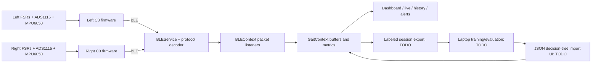

# Architecture and data contract

This describes code written as of 2026-09-11. App integration remains incomplete; see CURRENT_STATUS.md.

## Intended flow



Training is offline on a laptop. Inference is planned on the phone using a portable JSON decision tree. No server or cloud backend is needed for this baseline. A future neural model is optional, not a prerequisite for finishing the project.

## BLE identifiers

| Purpose | Value |
|---|---|
| Left advertised name | `GaitInsole-L` |
| Right advertised name | `GaitInsole-R` |
| Service UUID | `4fafc201-1fb5-459e-8fcc-c5c9c331914b` |
| Telemetry NOTIFY characteristic | `beb5483e-36e1-4688-b7f5-ea07361b26a8` |
| Command WRITE characteristic | `beb5483e-36e1-4688-b7f5-ea07361b26a9` |
| Current command payload | ASCII `tare` |

The new wire format is binary, not the legacy JSON packet described in old comments. The native BLE library returns Base64 wrapping the characteristic bytes. `src/core/protocol.js` handles that conversion without relying on Node Buffer in React Native.

## Protocol v1

One sample contains **32 payload bytes**, sent as **two 20-byte notifications**. All multi-byte integers use little endian. Both notifications carry the same 16-bit sequence number.

Fragment structure:

| Offset | Size | Meaning |
|---:|---:|---|
| 0 | 1 | Magic/version `0xA1` |
| 1 | 1 | Flags: bit 0 = fragment index (0/1); bit 1 = right foot; bit 2 = calibrated |
| 2 | 2 | Unsigned sequence, wraps at 65536 |
| 4 | 16 | Payload bytes 0–15 or 16–31 |

Payload structure after reassembly:

| Offset | Size | Type / units |
|---:|---:|---|
| 0 | 4 | uint32 device uptime in milliseconds |
| 4 | 8 | Four uint16 baseline-corrected ADS1115 counts |
| 12 | 6 | Three int16 acceleration values, millig |
| 18 | 6 | Three int16 gyro values, tenths of degrees/s |
| 24 | 4 | uint32 cumulative step counter for this boot |
| 28 | 4 | uint32 random boot identifier |

Decoder requires part 0 before part 1, matching sequence/flags/side, within 500 ms. An unmatched fragment is discarded. Duplicate/older samples are discarded by clock handling. Invalid side/version/frame length/ADC range raises an error.

At the target 50 Hz, this is 100 notifications/s/foot. Using 20-byte notifications avoids needing a larger MTU, but sustained queue throughput still needs measurement on real hardware. Sequence gaps are counted, not retransmitted.

## App packet representation

```text
version, side, seq, boot, deviceMs,
adc[4], fsr[4],
ax, ay, az, gx, gy, gz,
steps, calibrated, receivedAt, ts, dropped,
class, conf, alert
```

- `adc`: baseline-corrected converter counts, not pre-tare raw readings.
- `fsr`: display-normalized 0–4095. Formula: clamp(round(adc * 0.125 / 3300 * 4095), 0, 4095).
- `ax/ay/az`: g; `gx/gy/gz`: degrees/s.
- `receivedAt`: phone wall-clock receive time.
- `ts`: estimated sample time based on device uptime and minimum observed receive offset.
- `class`: `unknown` until inference succeeds; canonical labels in ML_PLAN.md.
- `conf`: model leaf probability, not a clinically calibrated confidence estimate.
- `demo`: true on synthetic samples; exported dataset must preserve this distinction.

The 0–4095 display scale is a normalized voltage scale, not a claim of native 12-bit conversion or absolute pressure. ADS1115 uses 16-bit conversion but single-ended positive counts; physical measurements must remain within supply rails regardless of selected gain range.

## Timing and metrics limitations

`createClock` handles device uptime wrap, boot changes, and sequence wrap. Its arrival-offset estimate is an initial approximation, not precise bilateral synchronization. Do not infer millisecond-level left/right gait phase or clinical symmetry from it without validation/improved synchronization.

`GaitContext` currently:

- Ingests samples into refs; publishes UI updates every 200 ms.
- Keeps approximately two seconds per foot, capped at 130 samples.
- Saves a JSON snapshot every ten seconds and on background transition.
- Uses different keys for demo and real data.
- Computes step deltas per boot; never adds an entire counter on first connection.
- Rolls daily totals into history on the next packet after local midnight.
- Marks a UI packet stale after two seconds without reception.
- Runs per-foot inference every one second on a two-second window when a model exists.
- Uses a provisional 0.7 probability threshold; lower predictions become unknown.
- Counts classification windows, not steps or clinically defined walking bouts.
- Creates at most one alert per foot per 30 seconds and keeps 200 alerts.

Current count symmetry: `100 * (1 - abs(leftSteps - rightSteps) / (leftSteps + rightSteps))`, null when total is zero. Label it as step-count balance; guard disconnected/missing-foot data. Do not reuse old report thresholds expecting a 0–1 value.

## Storage and recording

Snapshots: `@gaitsense_v2_real`, `@gaitsense_v2_demo`.

Model: `@gaitsense_model_v1`.

Legacy UserContext profile/settings/onboarding keys remain in use.

The new snapshot includes `day`, `stats`, `history`, `alerts`. On a new date the stored prior day is preserved and current totals begin at zero. Counters/rolling buffers are not persisted; reconnect starts a new observation baseline.

In-memory recording object:

```json
{
  "version": 1,
  "id": "session-<timestamp>",
  "participant": "P001",
  "label": "normal",
  "demo": false,
  "startedAt": 0,
  "packets": [],
  "stoppedAt": 0
}
```

Recording auto-stops after 60,000 packets or ten minutes and stops on app backgrounding. The implementation currently requires both sides fresh and calibrated before starting. Durable recording storage/export is still TODO.

## Model JSON schema

```json
{
  "version": 1,
  "kind": "decision_tree",
  "name": "descriptive-version-name",
  "windowMs": 2000,
  "features": ["p0_mean", "p0_std", "p0_min", "p0_max", "... exact 40 feature names ..."],
  "classes": ["standing", "normal"],
  "nodes": [
    { "feature": 0, "threshold": 0.2, "left": 1, "right": 2 },
    { "probs": [0.8, 0.2] },
    { "probs": [0.1, 0.9] }
  ]
}
```

This illustrates structure only, not a usable/trained model. Exact feature names are exported by `src/core/model.js`. Validation checks structure, labels, feature order, probabilities, depth, cycles and indices. Add malformed-file size/type tests before importing external JSON.
